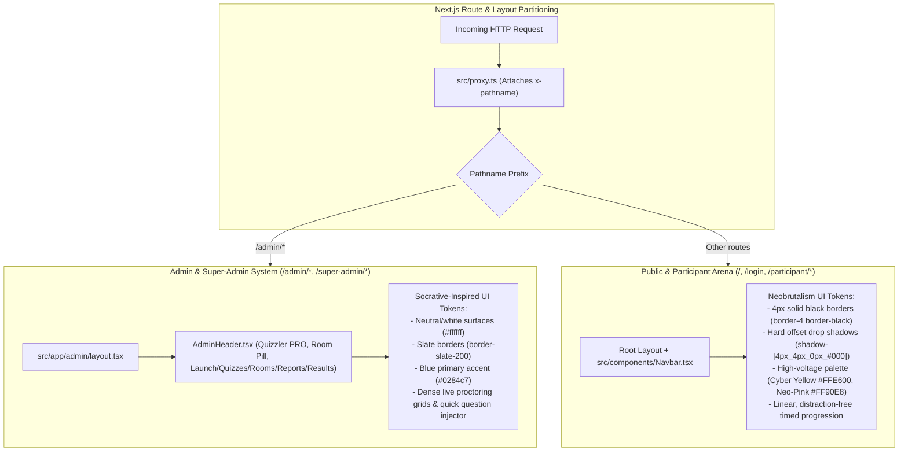
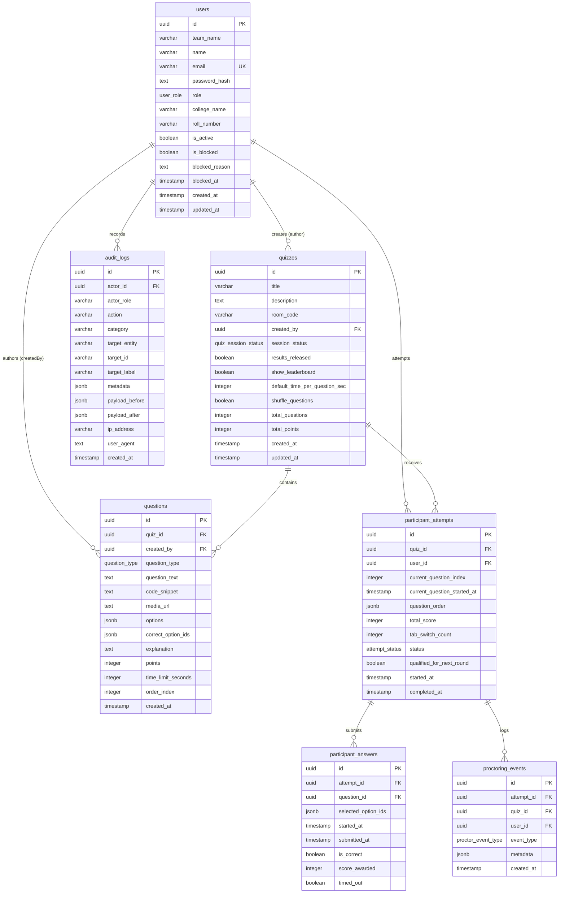

# System Architecture Document
## Quizzler — Live Competition & College Quiz Platform
### Tech Stack: Next.js &bull; Neon Managed PostgreSQL &bull; Drizzle ORM &bull; Tailwind CSS

---

### 1. Technology Stack & Architectural Decisions

| Layer | Technology | Rationale |
| :--- | :--- | :--- |
| **Framework** | Next.js 16+ (App Router) | React Server Components (RSC), Next.js Proxy (`src/proxy.ts`) for RBAC routing, and type-safe Server Actions. |
| **Language** | TypeScript (Strict Mode) | End-to-end typed contracts between Drizzle schema, API handlers, and React components. |
| **Styling** | Tailwind CSS (Dual System) | Clean Socrative-style proctoring dashboard for admins; bold high-contrast Neobrutalism for participants. |
| **Database** | Neon Serverless PostgreSQL | **Strict $0 budget**. Managed PostgreSQL with built-in PgBouncer connection pooling and zero-cost auto-suspend when idle. |
| **Database Driver**| `@neondatabase/serverless` | Serverless-optimized driver designed specifically for Neon's WebSocket / HTTP connection pooling. |
| **ORM** | Drizzle ORM | Zero-overhead, lightweight, type-safe SQL query builder and schema migration toolkit. |
| **Auth & Security**| Jose / JWT + bcryptjs | Stateless session management using HTTP-only cookies, stored and validated in PostgreSQL. |

---

### 2. Dual Design System Architecture



---

### 3. Neon Connection & Concurrency Strategy (100 Concurrent Participants)

#### 3.1 Two-Endpoint Topology
1. **Application Connection (`DATABASE_URL`):**
   - Uses the pooled connection host: `ep-xyz-pooler.<region>.aws.neon.tech`.
   - Neon routes queries through its internal PgBouncer instance in transaction pooling mode.
   - Prevents connection exhaustion when 100 concurrent participants submit answers simultaneously.
2. **Migration Connection (`DATABASE_URL_UNPOOLED`):**
   - Uses the direct endpoint: `ep-xyz.<region>.aws.neon.tech`.
   - Used exclusively by `drizzle-kit push` and `drizzle-kit migrate` for schema alterations and advisory locks.

#### 3.2 Single Pool Instance Pattern (`src/db/index.ts`)
To prevent opening redundant connections per HTTP request during development and serverless invocations:
- A singleton `Pool` instance is cached on `globalThis._neonPool`.
- Requests execute parameterized, prepared queries through Drizzle ORM.
- Queries are strictly indexed and keep transactions short (under 20ms) to release pooled connections immediately.

---

### 4. Relational Database Schema Design (`src/db/schema.ts`)



---

### 5. Multi-Admin Question Ownership & Security Invariants

1. **Explicit Creator Tracking:** Every question persists `created_by` linking directly to the organizer (`users.id`).
2. **Access Invariant:** A regular admin (`ADMIN`) can query, mutate, reorder, or delete only their own questions and parent quizzes. Cross-admin access triggers a strict `ACCESS_DENIED` rejection on the server.
3. **Super-Admin Supervision:** Super-admins (`SUPER_ADMIN`) possess global oversight to inspect questions and make proctor-level corrections across all admins.
4. **Data Corruption Prevention:**
   - A quiz with `sessionStatus === "LIVE"` cannot be deleted.
   - A quiz with existing participant attempts cannot be deleted.
   - Questions with already submitted participant answers cannot have their options, points, or correct answers modified.

---

### 6. Server-Authoritative Question Timer & Telemetry Flow

```mermaid
sequenceDiagram
    autonumber
    actor Participant as Participant Browser
    participant Server as Next.js Server Action
    participant DB as Neon PostgreSQL (Pooled)

    Participant->>Server: startOrResumeQuizAttempt(quizId)
    Server->>DB: Check active attempt & quiz status (LIVE)
    opt First Start
        Server->>DB: Fetch question IDs & Fisher-Yates shuffle
        Server->>DB: INSERT into participant_attempts (question_order, current_index=0, started_at=NOW())
    end
    Server-->>Participant: Return attemptId & totalQuestions

    Participant->>Server: getAuthoritativeCurrentQuestion(attemptId)
    Server->>DB: SELECT question using question_order[current_index]
    Server->>Server: Compute remaining = timeLimit - (NOW() - current_question_started_at)
    Server->>Server: Sanitize payload (strip correct_option_ids & explanation)
    Server-->>Participant: Deliver question JSON with authoritative remaining seconds

    Note over Participant: Client countdown bar ticks down. Tab switch / blur logs telemetry.

    alt Timely Submission (within timeLimit + 3s grace)
        Participant->>Server: submitAnswerAction(attemptId, questionId, selectedOptionIds)
        Server->>Server: Assert order & verify NOW() <= deadline
        Server->>Server: Grade on server using master key
        Server->>DB: INSERT participant_answers + UPDATE score & increment current_index
        Server-->>Participant: { success: true, isCompleted }
    else Expired Timer / Timeout
        Participant->>Server: submitAnswerAction (auto-triggered on 0s)
        Server->>Server: Detect NOW() > deadline
        Server->>DB: INSERT participant_answers (timed_out = true, score = 0)
        Server-->>Participant: { success: true, timedOut: true }
    end
```

---

### 7. Live Proctoring & Polling Architecture (Zero Extra Cost)

- **Polling Strategy:**
  - In order to stay strictly within the $0 budget, no third-party WebSocket service is used.
  - The Admin Live Proctor view polls `/api/admin/quizzes/:id/live` every 3–5 seconds.
  - Telemetry aggregates:
    1. Active attempts & participant progress.
    2. Overall and question-by-question class accuracy.
    3. Proctoring integrity events (tab switches & focus loss).
  - Single indexed round-trip keeps query time under 10ms on Neon pooled connections.

---

### 8. Result Visibility & Top 10 Leaderboard Security Architecture

1. **Blinded Evaluation State:**
   - While `quiz.results_released === false`, requests to `getParticipantResults` return only aggregate counts (e.g. Total Questions, Scorecard Status: "UNDER EVALUATION") and strictly omit `totalScore`, `isCorrect` per answer, `correctOptionIds`, and `explanation`.
   - Prevents cheating or leaking answers to peers who are still taking the quiz.
2. **Released Results State:**
   - When the admin sets `quiz.results_released = true`, `getParticipantResults` returns the complete breakdown including question text, selected options, correct answer keys, points awarded, and explanation.
3. **Leaderboard Privacy:**
   - Enabled when `quiz.show_leaderboard === true` or `quiz.results_released === true`.
   - Returns strictly the Top 10 participants sorted by `total_score DESC`, then duration `ASC`.
   - Exposes only public display metadata (`rank`, `teamName`, `userName`, `score`, `accuracyRate`, `durationSeconds`); participant email, database IDs, and sensitive tokens are completely hidden.

---

### 9. Superadmin Dev-Ops Console & Activity Logging Architecture

1. **Dark Linear Workspace Isolation:**
   - Superadmin views (`/super-admin/*`) use a dedicated dark theme (`#0A0D14` obsidian canvas, `#111726` panels, `#1E293B` borders).
   - Component styles and layouts are strictly encapsulated to avoid altering regular admin (Socrative) or participant (Neobrutalism) design systems.
2. **Append-Only Structured Activity Logging:**
   - Implemented via `audit_logs` table in PostgreSQL with indexes on `created_at` (DESC) and `category`.
   - Records machine-readable actions across categories (`AUTHENTICATION`, `QUIZ`, `USER_MANAGEMENT`, `SECURITY`).
   - Credentials (passwords, hashes, tokens) and secret keys are programmatically sanitized and never stored in log metadata.
3. **Account Blocking Architecture:**
   - Sets `is_blocked = true`, `blocked_reason = reason`, `blocked_at = NOW()`, `is_active = false` on `users`.
   - Enforced at authentication and session validation boundaries (`requireRole`, `getCurrentUser`, `getRequiredAdminSession`).
   - Immediately revokes active access without requiring token expiration or database record deletion.
4. **Master Answer Vault & Key Inspector:**
   - Consolidated single-query view for superadmins displaying all questions, verified master keys, and live choice distribution percentages (A/B/C/D).
   - Corruption guard: Question options, points, and master answer keys cannot be modified if participant submissions already exist.
5. **Inactive Operational CLI:**
   - Embedded bottom terminal panel (`root@quizzler:~$`) is visually modeled after modern Dev-Ops consoles.
   - Command interpreter is strictly disabled; inputs are read-only with zero backend execution endpoints.
